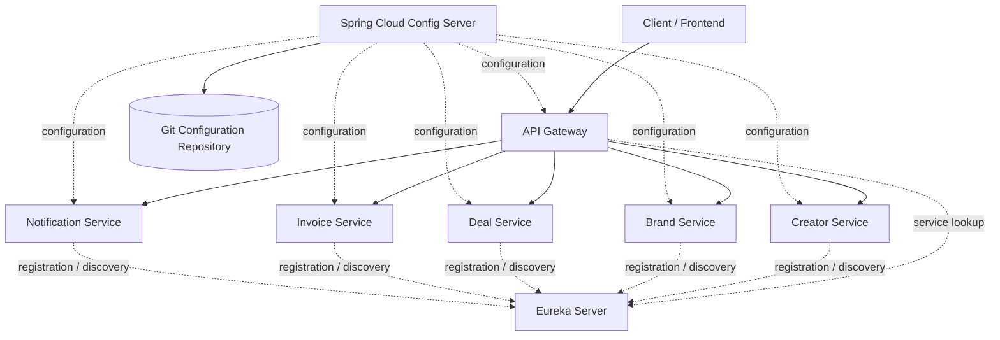

# Creator Deal SaaS

A Java and Spring Boot microservices backend for a platform that helps creators manage brand relationships, deals, invoices, and notifications.

> **Project status:** In development. This README distinguishes implemented components from planned integrations. Verify the checklist against the latest code before publishing.

## Overview

Creator Deal SaaS explores production-oriented backend patterns through independently deployable services, centralized API routing, service discovery, resilient inter-service calls, and centralized configuration.

## Architecture



Each business service is intended to own its domain logic and data. Service-to-service communication uses Spring Cloud discovery and load balancing rather than hard-coded instance addresses.

## Tech stack

- **Language:** Java 21
- **Framework:** Spring Boot 3.5, Spring Cloud
- **Routing:** Spring Cloud Gateway
- **Discovery:** Netflix Eureka
- **Configuration:** Spring Cloud Config with a Git backend
- **Resilience:** Resilience4j
- **Inter-service communication:** REST and OpenFeign (verify current integration)
- **Persistence:** PostgreSQL and Spring Data JPA (service-specific configurations)
- **Build:** Maven
- **Messaging:** RabbitMQ (documented in the original application flow; verify running integration)
- **Development tools:** IntelliJ IDEA, Docker

## Services

| Component | Default port | Database | Responsibility |
| --- | --- | --- | --- |
| API Gateway | Configured separately | — | Single entry point and routing to backend services |
| Eureka Server | 8070 | — | Service registration and discovery |
| Config Server | 8071 | — | Centralized configuration retrieved from Git |
| Creator Service | 8081 | `creator_db` | Creator profiles and related domain operations |
| Brand Service | 8082 | `brand_db` | Brand information and management |
| Deal Service | 8083 | `deal_db` | Deals and deliverables |
| Invoice Service | 8084 | `invoice_db` | Invoicing operations |
| Notification Service | 8085 | `notification_db` | Notifications and reminders |

## Implementation progress

### Built / explored

- [x] Split the application into domain-oriented microservices
- [x] Implemented REST-based service communication
- [x] Added resilience patterns with Resilience4j
- [x] Added API Gateway routing
- [x] Integrated Eureka for service registration and discovery
- [x] Created Spring Cloud Config Server
- [ ] Verify Git-backed Config Server access and client configuration end to end

### Planned

- [ ] Confirm OpenFeign integration and service-to-service calls against the current code
- [ ] Verify RabbitMQ event publishing/consumption end to end (described in the original README)
- [ ] Keycloak authentication and JWT-based authorization
- [ ] Centralized logging, metrics, and tracing
- [x] Added a root `docker-compose.yml` for local infrastructure (verify services and credentials)
- [ ] Kubernetes deployment and orchestration
- [ ] AI-assisted features

## Getting started

### Prerequisites

- Java 21
- Maven
- PostgreSQL databases configured for the applicable services
- Git
- Docker (for optional infrastructure such as Keycloak and RabbitMQ)

### 1. Start local infrastructure

The repository includes `docker-compose.yml`. Inspect the services and environment variables before starting:

```bash
docker compose up -d
```

The original setup uses PostgreSQL and RabbitMQ. If RabbitMQ management is enabled, its local dashboard is at `http://localhost:15672` (development defaults may be `guest` / `guest`). Set database credentials via local environment variables rather than committing real passwords.

### 2. Prepare the configuration repository

Create a separate Git repository for configuration files. For example:

```text
creator-deal-config/
├── application.yml
├── api-gateway.yml
├── creator-service.yml
├── brand-service.yml
├── deal-service.yml
├── invoice-service.yml
└── notification-service.yml
```

Avoid committing database passwords, Git tokens, and other secrets. Use environment variables or a secret manager instead.

### 3. Configure Config Server

The Config Server's local `application.yml` can contain:

```yaml
server:
  port: 8071
spring:
  application:
    name: config-server
  cloud:
    config:
      server:
        git:
          uri: ${CONFIG_GIT_URI}
          default-label: main
          clone-on-start: true
```

Set `CONFIG_GIT_URI` to your Git configuration repository URL. For private repositories, configure a read-only token through environment variables (`CONFIG_GIT_USERNAME` and `CONFIG_GIT_TOKEN`) and map them to the Git backend's `username` and `password` properties. Do not commit the token.

### 4. Configure each client

For example, the Deal Service's local `application.yml`:

```yaml
spring:
  application:
    name: deal-service
  config:
    import: configserver:http://localhost:8071
```

Ensure the matching `deal-service.yml` exists in the Git repository. Configure required database credentials in the environment of the service that uses them.

### 5. Build and start the applications

Build all Maven modules from the repository root:

```bash
mvn -DskipTests package
```

Start services in this order for the current local setup:

1. Eureka Server (port `8070`)
2. Config Server (port `8071`)
3. Business services
4. API Gateway

Use individual IntelliJ run configurations or Maven commands such as `mvn -pl creator-service spring-boot:run`, `mvn -pl brand-service spring-boot:run`, `mvn -pl deal-service spring-boot:run`, `mvn -pl invoice-service spring-boot:run`, and `mvn -pl notification-service spring-boot:run` in separate terminals. These are example commands; ensure required dependencies and config are available. The service ports shown above are from the original README and may be overridden by central configuration.

### 6. Verify

- Eureka dashboard: `http://localhost:8070/`
- Config Server configuration endpoint: `http://localhost:8071/deal-service/default/main`
- Gateway: send a request to a route configured for one of the business services

A successful Config Server response should include `propertySources` from the Git repository. Keep configuration endpoints private in production because they may expose sensitive properties.

## Example API endpoints

The original project README documents these direct-service endpoints (verify mappings in the current code before using them):

```http
POST http://localhost:8081/api/creators
POST http://localhost:8082/api/brands
POST http://localhost:8083/api/deals
POST http://localhost:8083/api/deliverables
POST http://localhost:8084/api/invoices
GET  http://localhost:8085/api/reminders/creator/{creatorId}
```

Once Gateway routing is configured, prefer accessing the services through Gateway routes rather than exposing every business service publicly.

## Event-driven business flow

The original implementation documentation describes the following workflow:

1. `deal-service` publishes deal and deliverable events.
2. `invoice-service` publishes invoice events.
3. `notification-service` consumes events and creates reminders when due dates are present.

RabbitMQ is the intended messaging infrastructure. This behavior comes from the original README and should be tested against the latest code before claiming it is fully operational.

## Key engineering concepts

**Service discovery:** Services register with Eureka; consumers can resolve logical service names rather than fixed hosts and ports.

**Load balancing:** Spring Cloud LoadBalancer selects among available service instances for `lb://` routes and supported clients.

**Resilience:** Resilience4j patterns help contain downstream failures. Timeouts, retries, and circuit breakers should be configured according to the operation's idempotency and failure semantics.

**Centralized configuration:** Spring Cloud Config separates runtime configuration from application code, allowing services to retrieve environment-specific properties from a dedicated Git repository.

## Roadmap

The next development focus is securing the platform with Keycloak, OAuth2/OIDC, and JWT validation at both the Gateway and business-service layers. RabbitMQ messaging, observability, and container orchestration follow in later milestones.

## Notes

This project is a learning and portfolio project. It is not yet presented as a production-deployed system. Update the progress checklist, setup instructions, and diagrams as implementation advances.
